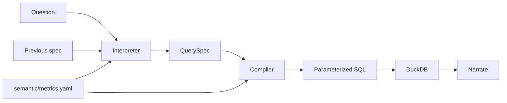

# Fleetline

Conversational analytics for a **synthetic fleet-card portfolio**. Ask in plain English. Fleetline turns the question into a structured spec, compiles that spec with the semantic layer, and answers with one sentence, the number, a chart, and the rows.

No API keys. No network calls. Every customer, merchant, and transaction is invented.

```sh
make setup
make test
make app    # http://127.0.0.1:8000
```

## Problem restatement

Fleet and credit leaders ask the same questions every week — fuel spend, fraud losses, price per gallon, delinquency — and get a different number depending on who writes the SQL. A text-to-SQL chatbot makes that worse: two phrasings can become two queries.

Fleetline answers from **one definition of each metric**. The interpreter may only choose a metric, breakdowns, and filters that exist in `semantic/metrics.yaml`. The compiler is the only component that writes SQL, and it binds every value as a parameter. The sentence is a template over those rows, so the wording cannot invent a figure.

A follow-up (“and for Texas”, “break that down by product”) edits the previous spec. It does not start a new, unrelated query.

## Use cases and non-goals

**Use cases**

- Ask a question and get one sentence, the number, a chart, and the rows.
- See the spec that was run: metric, breakdown, filters, time range, and the compiled SQL.
- Rephrase a known question and get the same spec.
- Follow up in the same conversation. Geography, metric, time, and breakdown can change independently.
- Ask something ambiguous, off-topic, or only half-specified and get a clarification instead of a guessed number.
- Regenerate the portfolio from seed 42 and find the same planted stories.

**Non-goals**

- Free-form SQL, or an LLM that writes SQL or the answer sentence.
- More than one metric in a question (“spend and gallons”).
- Filtering by a customer’s name. “Top customers” groups by name; it does not search names.
- Benefits, payments, forecasting, authentication, or a warehouse.
- Arbitrary ranges such as “3 May through 9 May”. The time phrases in the design section are the supported set.
- Remembering a conversation after the process restarts. Sessions are in memory.

## API and interfaces

Local FastAPI at `http://127.0.0.1:8000`. Unknown request fields are rejected (`422`). A blank question is `400`. An off-topic, unknown, or incomplete question is `200` with `status: "clarify"`.

| Method | Path | Body | Returns |
|---|---|---|---|
| GET | `/api/health` | — | status, as-of date, row counts, semantic version |
| GET | `/api/catalog` | — | metrics, dimensions, examples |
| POST | `/api/ask` | `{ "question", "session_id"? }` | an answer or a clarification |

`session_id` is optional. The response always returns one. The next question in that session is a follow-up.

An answer’s `spec` is the only input to the compiler:

| Field | Meaning |
|---|---|
| `metric` | key in `semantic/metrics.yaml` |
| `group_by` | zero to two dimension keys |
| `filters` | `{ "dimension", "values"[] }` |
| `time_range` | `{ "start", "end", "label" }` |
| `order` | `asc` or `desc`, applied when sorting by the value |
| `order_by` | `value` or `month` |
| `limit` | integer 1–100, or null |

`highlight` is the number the sentence leads with (`total`, `leader`, or `peak`). `chart.type` is `bar` or `line`. `sql` uses `?` placeholders; `params` holds the bound values.

Main functions: `resolve(question, previous)` in `src/fleetline/nlu.py` returns a spec or a clarification. `compile_spec(spec)` in `src/fleetline/compiler.py` returns SQL and parameters. `ask(question, session_id)` in `src/fleetline/service.py` runs the path end to end.

## Test scenarios

`make test` runs the suite. The scenarios below were fixed before implementation.

| Scenario | Where it is asserted |
|---|---|
| Each listed question maps to one metric, breakdown, filters, time, order, and limit | `tests/test_nlu.py` |
| “this year”, “last quarter”, “last 3 months”, “last month”, and “July 2026” resolve against 30 Sep 2026 | `tests/test_time.py` |
| A follow-up edits the previous spec; “and for Texas” drops a region breakdown and keeps a month breakdown | `tests/test_conversation.py` |
| Identifiers in SQL come from the catalog; a hostile filter value appears only in the parameter list | `tests/test_compiler.py` |
| Metric synonyms are unique, and invoice SQL cannot reference card or merchant aliases | `tests/test_catalog.py` |
| Seed 42 rebuilds the same amounts; seed 99 does not | `tests/test_data.py` |
| Texas skimming spikes in July 2026, SecureFuel’s fraud rate is lower, Technology leads EV share, Enterprise is the most delinquent, West diesel is more expensive than Midwest diesel | `tests/test_stories.py` |
| `/api/ask` and `/api/health` match this contract, including a blank question and an unknown field | `tests/test_api.py` |

## Design



| Module | Responsibility |
|---|---|
| `semantic/metrics.yaml` | Metrics, dimensions, synonyms, examples. The only place a metric’s SQL fragment is defined |
| `src/fleetline/nlu.py` | Question → spec, including follow-ups and clarification |
| `src/fleetline/timeparse.py` | Time phrases, anchored on 30 Sep 2026 |
| `src/fleetline/compiler.py` | Spec → one `SELECT`. The only SQL writer |
| `src/fleetline/narrate.py` | Deterministic sentence |
| `src/fleetline/generate.py` | Seeded portfolio and the planted stories |
| `src/fleetline/store.py` | Parquet files queried through DuckDB |
| `src/fleetline/service.py` | Sessions, execution, chart metadata |
| `src/fleetline/api.py` | HTTP API and the static UI |
| `src/fleetline/static/` | Ask page and the definitions page |

### Interpreter rules

1. Relative dates anchor on **30 Sep 2026**, the last day in the data, not on the wall clock.
2. With no time phrase, the range is **1 Apr 2025 – 30 Sep 2026**.
3. The longest metric phrase wins. Two different metrics of the same length, or a second metric phrase left in the question, ask for clarification.
4. A word that is not a metric, breakdown, filter, time phrase, or function word asks for clarification. “Fuel spend on the moon” does not return portfolio spend.
5. “in Texas” filters **merchant state** for card metrics and **customer state** for invoice metrics. “home state”, “customer state”, and “fleet state” always mean the customer.
6. “in the Southwest” filters **region**: the merchant’s region for card metrics, the customer’s region for invoices.
7. Breakdown limits: plain “by region” returns 25 rows sorted by value; “which” / “highest” / “lowest” return 10; “top N” returns N. A month breakdown with no ranking language is chronological and uncapped.
8. A follow-up edits the last **answered** spec. A clarification does not change the session.
9. A new geography filter (region, customer state, merchant state) replaces any previous geography filter and removes geography from the breakdown. A product or segment filter keeps the breakdown. “break that down by product” replaces the breakdown.
10. Weather, sports, recipes, and similar topics are declined even if they mention a state.

Supported time phrases: this year, year to date, last year, this quarter, last quarter, this month, last month, last N months (digit or word), `Q3 2026`, `July 2026`, and a bare year such as `2025`.

“This quarter” is the quarter that contains 30 Sep 2026 (Q3). “Last quarter” is the one before it (Q2 2026). “Last month” is August 2026. “This year” is 1 Jan 2026 through 30 Sep 2026.

### Data model

Seed **42**. Grain and fields:

| Table | Grain | Fields that questions use |
|---|---|---|
| `customers` | fleet | name, industry, segment, region, home state, card program |
| `cards` | card | vehicle class, fuel type, SecureFuel |
| `merchants` | site | category, state, region, in network |
| `transactions` | authorization | date, product, gallons, amount, auth status, fraud flag, fraud type |
| `invoices` | customer × month | billed, paid, days past due, write-off |

About 5,200 transactions, 37 fleets, 18 months.

Regions: Northeast, Southeast, Midwest, Southwest, West. Products: Diesel, Unleaded, Premium, DEF, Electricity. Segments: Small, Mid-market, Enterprise. Industries: Transportation, Construction, Energy, Technology, Government, Retail.

**Planted stories** (so the demo is about something, not a flat random cloud):

- **Texas skimming, July 2026.** Thirty approved diesel sales at Red Mesa Travel Center, $720 each, on a standard card. Fraud losses in that month dwarf every other month.
- **SecureFuel.** The planted fraud is on a standard card, and SecureFuel cards are almost never marked fraudulent.
- **EV share.** Half the cards at Technology fleets are electric, and those charges are large. Technology leads EV share of spend.
- **Delinquency.** Enterprise invoices are more than 30 days past due in 6 of 18 months, mid-market in 2, small in none.
- **West diesel.** Diesel sold at West merchants is priced about $0.90 above diesel sold in the Midwest.

Definitions and the incident note also live in `semantic/glossary.md`.

### Why this shape

The spec is the contract between language and arithmetic. Hashing prose would not prove two answers are the same number. Returning the spec, the SQL, and the rows does. Follow-ups merge specs instead of appending chat text, so “and for Texas” cannot accidentally change the metric.

## How to run

Python 3.10 or newer. This machine uses 3.12. From the repo root:

```sh
make setup
make test
make app
```

Then open `http://127.0.0.1:8000`.

One question from the shell:

```sh
make ask Q="Fraud losses by merchant state in July 2026"
```

The first launch writes parquet files under `data/` (a second or two). They are not committed. `make clean-data` deletes them.

`PORT=8001 make app` uses another port.

### Try these

- Top 5 customers by spend this year
- Monthly fraud losses in the Southwest
- and for Texas
- How much did we lose to skimming in Texas in July 2026?
- Fraud rate by SecureFuel status
- Diesel vs unleaded price per gallon in the West
- Which industry has the highest EV share?
- Delinquency rate by segment
- What’s the weather in Dallas?

The weather question should refuse. “and for Texas” after the monthly Southwest question should keep fraud losses, keep the month breakdown, and move the filter to Texas.

## Assumptions and shortcuts

- One local user. No authentication.
- DuckDB reads parquet in memory. There is no warehouse.
- The interpreter is a phrase matcher over the catalog, not a model. Phrases it does not know are refused rather than guessed.
- “Last year” is calendar 2025, but the portfolio starts on **1 Apr 2025**, so January–March 2025 are empty on purpose.
- A question can use one metric and up to two breakdowns.
- “a vs b” understands a single word on each side (“diesel vs unleaded”), not a multi-word name.
- Sessions live in the server process. Restarting forgets them. The page keeps the session id in memory only.
- Do not commit `data/*.parquet`. There are no API keys in this project.

## What I would do next

- Persist sessions, and accept “same again” after a restart.
- Let an optional model propose a spec (catalog keys only) when the phrase matcher refuses, still compiled by `compiler.py`.
- Add the benefits and payments facts the same way: a fact, metrics, and golden questions.
- Row-level security by customer, and a warehouse connection behind `store.py`.

## Repository map

| Path | What |
|---|---|
| `README.md` | This spec: problem, API, scenarios, design, how to run |
| `DESIGN.md` | Module notes and the SQL safety boundary |
| `semantic/metrics.yaml` | Governed metrics and dimensions |
| `semantic/glossary.md` | Business definitions and the planted stories |
| `src/fleetline/` | Generator, store, interpreter, compiler, API, UI |
| `tests/` | The scenarios in the table above |
| `scripts/ask.py` | One-shot CLI |
